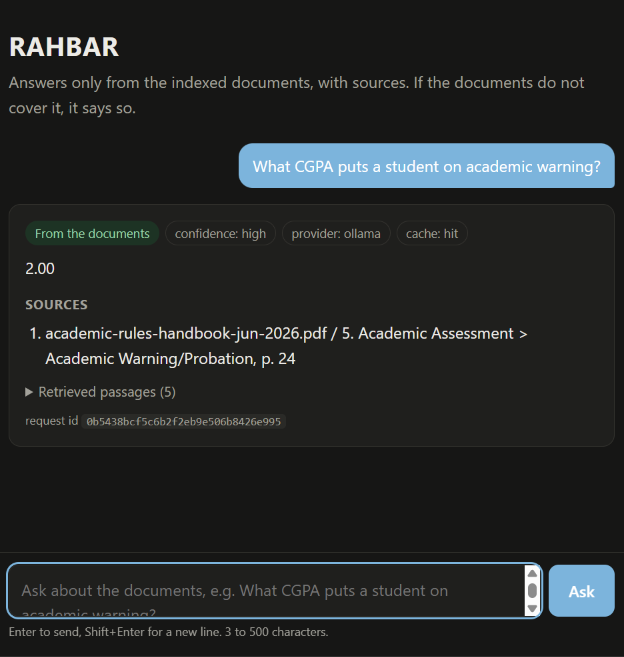
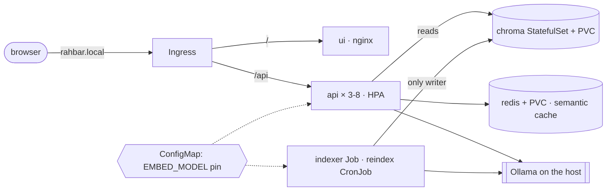

# RAHBAR: grounded answers from FAST-NUCES documents, on Kubernetes

[](https://github.com/OWNER/REPO/actions/workflows/ci.yml)
[](https://github.com/OWNER/REPO/actions/workflows/cd.yml)

A 5th-semester student wants to know whether they can register for a course after failing
its prerequisite. The answer is a clause in a handbook PDF on the university website, and
last year's handbook, with different rules, is still on the website too. A general chatbot
will answer confidently about some other university. **RAHBAR answers only from the
FAST-NUCES documents it has indexed, cites the source and section of every claim, prefers
the current version of a policy, and says "the documents do not cover this" when they
don't.** It runs as a set of objects on Kubernetes: it re-indexes without a redeploy,
scales horizontally, survives a deleted pod, and has a CI gate that fails the build when
retrieval quality drops.

Course assignment 02 (CS4032 / AI Engineering), FAST-NUCES Islamabad. Team: Meerab Riaz
(24I-3173) and **PARTNER NAME (roll no.)**.



## Architecture



Indexing runs once, and again when the material changes, in a **Job**; querying runs on
every question in the **api**, which never writes to Chroma (ADR 0001). Details:
[docs/ARCHITECTURE.md](docs/ARCHITECTURE.md) · ADRs in [docs/adr/](docs/adr/).

| Document | What it covers |
| --- | --- |
| [docs/CORPUS.md](docs/CORPUS.md) | the nine documents and the seven required properties |
| [docs/PIPELINE.md](docs/PIPELINE.md) | extraction, cleaning, chunking measurements, embedding pin, cache threshold, eval method |
| [docs/FAILURE-ANALYSIS.md](docs/FAILURE-ANALYSIS.md) | four stages broken on purpose |
| [docs/ENGINEERING-NOTES.md](docs/ENGINEERING-NOTES.md) | the seven questions |
| [docs/AI-USAGE.md](docs/AI-USAGE.md) | what AI wrote and what we changed |

## API

| Method | Path | Purpose |
| --- | --- | --- |
| POST | /api/ask | `{"question": "...", "history": []}` (3-500 chars) → answer, citations, `answered_from_context`, `confidence`, `retrieved`, `cached` |
| GET | /healthz | liveness: the process is alive; touches no dependency |
| GET | /readyz | readiness: Chroma reachable, active collection non-empty, embedding model matches `EMBED_MODEL`, Redis reachable; 503 names what failed |
| GET | /metrics | Prometheus: requests, latency, retrieval and generation latency, cache hits/misses and ratio, abstentions, fallbacks, retries, dropped citations, tokens in/out |

Every response carries `X-Request-ID` (yours, or generated) and `X-Cache: HIT|MISS`; every
log line is JSON on stdout with the request id.

## From a clean clone to an answered question

You need Docker, minikube, kubectl, Python 3.12, make, and [Ollama](https://ollama.com).
On Windows, run everything inside WSL 2.

```bash
git clone https://github.com/OWNER/REPO.git rahbar && cd rahbar

# 1. Cluster: minikube with Calico (the default CNI ignores NetworkPolicy), metrics-server, ingress
make cluster

# 2. Models on the laptop; the cluster reaches them at host.minikube.internal:11434
OLLAMA_HOST=0.0.0.0 ollama serve &          # all interfaces, not only 127.0.0.1
ollama pull llama3.2:3b
ollama pull nomic-embed-text

# 3. Images, built locally and loaded into minikube (imagePullPolicy: IfNotPresent)
make images

# 4. Apply, in this order (the namespace is part of the overlay)
kubectl apply -k k8s/overlays/dev
#    only for LLM_PROVIDER=hosted:  export LLM_API_KEY=...  &&  make secret

# 5. Wait: chroma and redis come up, the indexer Job fetches the corpus from nu.edu.pk,
#    indexes it and exits; the api pods become READY only when the index exists
kubectl -n rahbar rollout status statefulset/chroma
kubectl -n rahbar wait --for=condition=complete job/indexer --timeout=30m
kubectl -n rahbar rollout status deployment/api

# 6. Ask through the Ingress (Linux: the minikube IP; macOS/Windows: run `minikube tunnel`
#    in another terminal and add INGRESS_IP=127.0.0.1)
make ask Q="What CGPA puts a student on academic warning?"
make ask Q="What is the monthly hostel rent?"        # declines: not in the corpus
```

Open the UI at `http://rahbar.local` after adding `<minikube ip> rahbar.local` (or
`127.0.0.1 rahbar.local` with the tunnel) to `/etc/hosts`.

**Re-index without a redeploy** (new documents, or a changed `CHUNK_SIZE`):

```bash
kubectl create job --from=cronjob/reindex manual-reindex-1 -n rahbar     # or: make index
```

The new index is built in a new collection and switched to atomically; the API follows it
within 10 s and the semantic cache is invalidated at the same moment.

**Delete a pod, nothing breaks:** `kubectl delete pod -n rahbar -l app.kubernetes.io/name=api --wait=false`
then `kubectl get endpoints api -n rahbar`; the Deployment replaces it and the other two
keep serving. `kubectl delete pod chroma-0 -n rahbar`: the StatefulSet re-attaches the
same PVC and the index is still there.

## The corpus

FAST-NUCES public documents (Academic Rules Handbooks Jun 2025 *superseded* and Jun 2026,
Student Handbook 2026, prospectus rules, two annual reports, fee and FAQ pages, a scanned
ORIC policy). **We do not commit the PDFs.** `corpus/sources.yaml` lists them,
`corpus/MANIFEST.md` records each URL with its SHA-256, and `corpus/fetch.py` downloads
them (`make fetch` locally; the indexer Job's init container in the cluster).

## Development

```bash
make install && make test && make lint      # stubs only: no cluster, no model, no network
make dev                                    # api + UI with stubs on http://localhost:8000
make tune                                   # chunk-size measurements (needs Ollama + make fetch)
make cache-threshold                        # cache threshold measurements
make eval                                   # golden set through the Ingress, with the gate
make check                                  # the submission checker
```

Branches: `dev` for work; `main` is protected (pull request, CI green, one approval).
`ci.yml` (PR to main, push to dev): lint · test (coverage ≥ 60 %) · manifests (kustomize |
kubeconform -strict) · build · Trivy scan · **e2e-eval** on a kind cluster with the fixture
corpus and the section 5.4 gate. `cd.yml` (push to main): test → build-push to Docker Hub
tagged with the commit SHA → deploy to an ephemeral kind cluster, rollout status, smoke
test through the Ingress. Images: `https://hub.docker.com/u/DOCKERHUB_USER`.

## Secrets

Nothing secret is in this repository. The only secret is the optional hosted-LLM key,
created from the command line (`kubectl create secret generic rahbar-secret -n rahbar
--from-literal=LLM_API_KEY="$LLM_API_KEY"`, i.e. `make secret`).
`k8s/base/secret.placeholder.yaml` documents its shape with `REPLACE_ME` and is not
applied. CI uses GitHub Secrets `DOCKERHUB_USERNAME` and `DOCKERHUB_TOKEN` (an access
token).

## Licence

MIT, see [LICENSE](LICENSE). The FAST-NUCES documents belong to the university and are
fetched, not redistributed.
