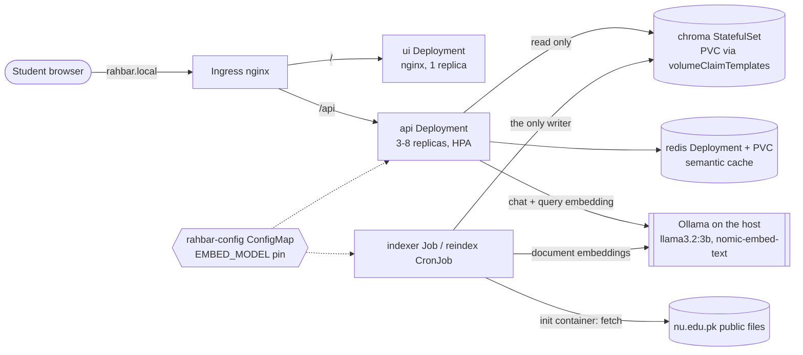

# Architecture

**Two paths that never share a process.** The indexer (Job, weekly CronJob) prepares
once and writes Chroma; the API answers every question and only reads it (ADR 0001).
Both read `EMBED_MODEL` from the same ConfigMap key; the indexer writes it into the
collection metadata and the API refuses readiness on a mismatch (section 4.4).

## Objects (namespace `rahbar`)
| Object | File | Notes |
| --- | --- | --- |
| Namespace | `k8s/base/namespace.yaml` | never `default` |
| Deployment api | `api-deployment.yaml` | 3 replicas, startup/liveness/readiness probes, requests+limits, maxSurge 1 / maxUnavailable 0, preStop sleep 5, grace 30 s |
| Deployment ui | `ui-deployment.yaml` | nginx-unprivileged on 8080, read-only root, `/tmp` emptyDir |
| StatefulSet chroma | `chroma-statefulset.yaml` | 1 replica, `volumeClaimTemplates` 2 Gi, `chromadb/chroma:1.0.12` |
| Deployment + PVC redis | `redis.yaml` | AOF persistence, Recreate strategy |
| Job indexer | `indexer-job.yaml` | `restartPolicy: OnFailure`, `backoffLimit: 3`, init container fetches the corpus |
| CronJob reindex | `reindex-cronjob.yaml` | weekly, same image and command, `concurrencyPolicy: Forbid` |
| Services | `services.yaml` | api, ui, chroma, chroma-headless, redis, all ClusterIP |
| Ingress | `ingress.yaml` | host `rahbar.local`: `/` → ui, `/api` → api |
| ConfigMap | `configmap.yaml` | chunking, top_k, floor, cache threshold, temperature, EMBED_MODEL, LLM_PROVIDER, CHROMA_HOST |
| Secret | created by `make secret` | `secret.placeholder.yaml` documents the shape only |
| NetworkPolicy | `networkpolicy.yaml` | deny all, then DNS, ui←ingress, api←ingress/ui, chroma←api/indexer, redis←api |
| HPA | `hpa.yaml` | api, 3 → 8, CPU 70 % |
| ServiceAccounts | `serviceaccounts.yaml` | one per workload, no token mounted |

## Why Chroma is a StatefulSet, not a Deployment
A vector store is state. The StatefulSet gives the pod a stable identity (`chroma-0`,
DNS `chroma-0.chroma-headless`) and a PersistentVolumeClaim created from
`volumeClaimTemplates` that is bound to that identity: if the pod is deleted or moved, the
replacement re-attaches the same volume and the index survives. A Deployment has no
per-pod claim; with a shared RWO claim its rolling update starts the new pod before the
old one stops (two writers on one volume, or a new pod stuck Pending on the attach), and
with no claim the index vanishes on every restart (−8 in section 8). Ordered, one-at-a-time
start and stop is also what a single-writer database wants.

## Security (section 4.7)
| Hole | Closure here |
| --- | --- |
| Secrets in Git | `*secret*.yaml` gitignored except `*placeholder*`; the key is created with `kubectl create secret … --from-literal`; CI uses GitHub Secrets |
| Everything is admin | one ServiceAccount per workload, `automountServiceAccountToken: false` on every pod |
| Containers as root | `runAsNonRoot: true`, `readOnlyRootFilesystem: true`, `capabilities.drop: [ALL]`, `allowPrivilegeEscalation: false`, seccomp RuntimeDefault; writable `/tmp` emptyDirs only |
| Flat network | `networkpolicy.yaml`; the ui pod has DNS egress only, so it cannot reach chroma |
| Unsafe model output | schema-constrained, Pydantic-validated, citations re-checked, injection echo blocked, never `eval`'d, never used to build a query |
